# Lembar — Sewa E-book (UTS Pemrograman Web 2026/2027)

Aplikasi web tanpa framework: front-end HTML/CSS/JS + backend PHP 8.x OOP.
Penyimpanan data memakai file JSON di folder `data/`.

## Tampilan Aplikasi

Semua tangkapan layar diambil dengan data seed bawaan. Berkas ada di [`docs/screenshots/`](docs/screenshots/).

### Katalog dan detail media

| Katalog | Dark mode |
|---|---|
| 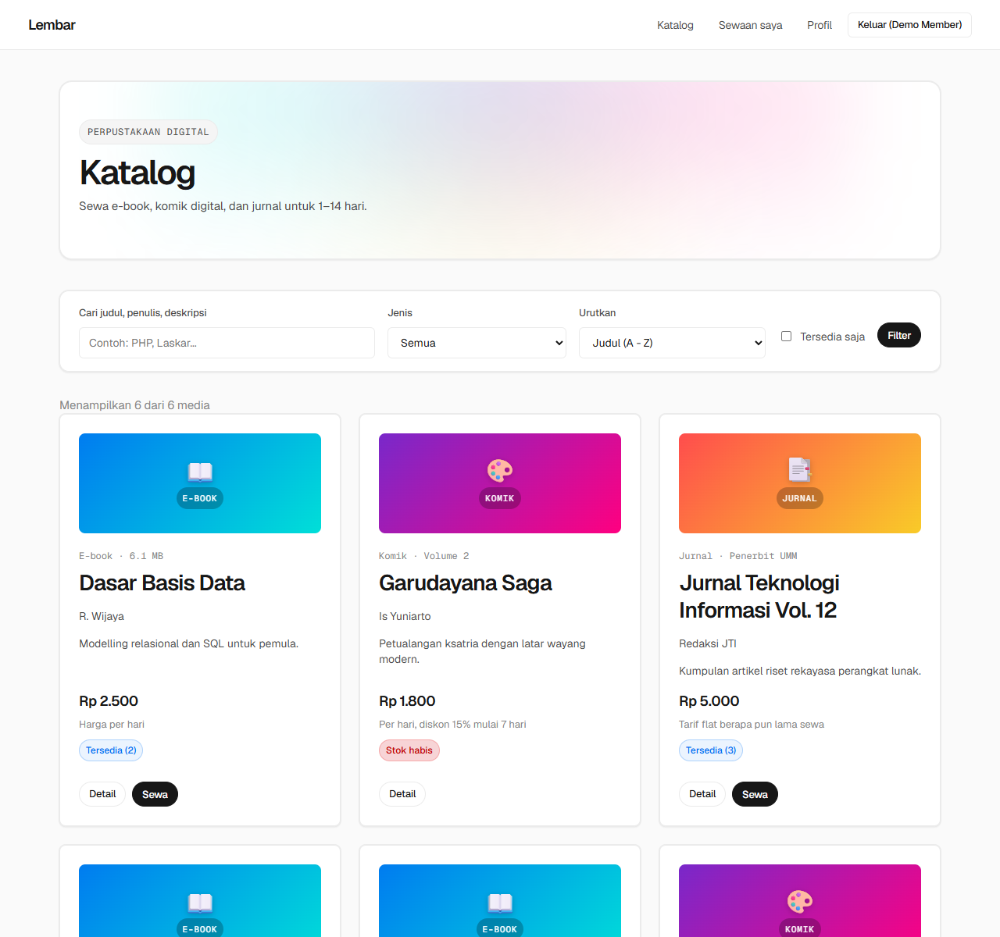 | 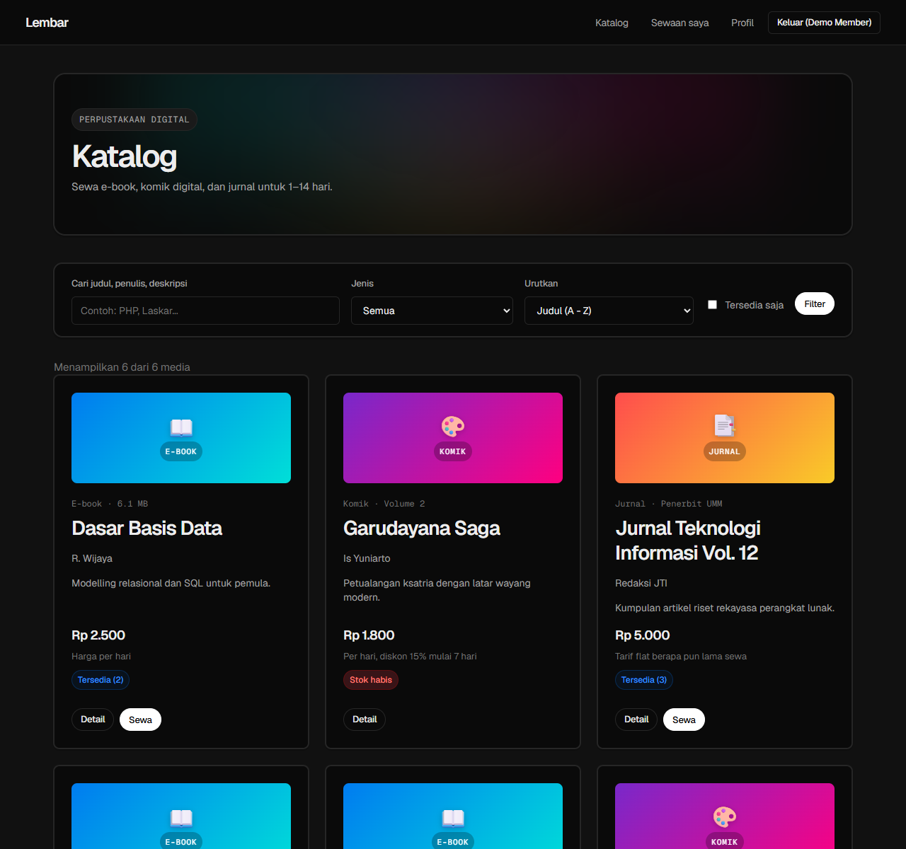 |

| Detail media | Dialog sewa |
|---|---|
| 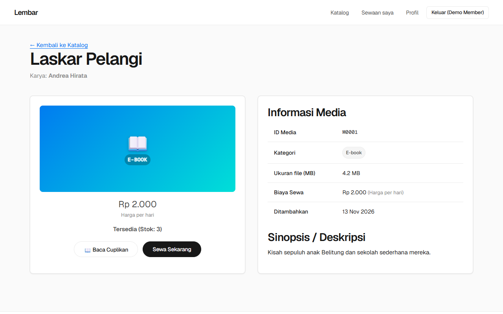 | 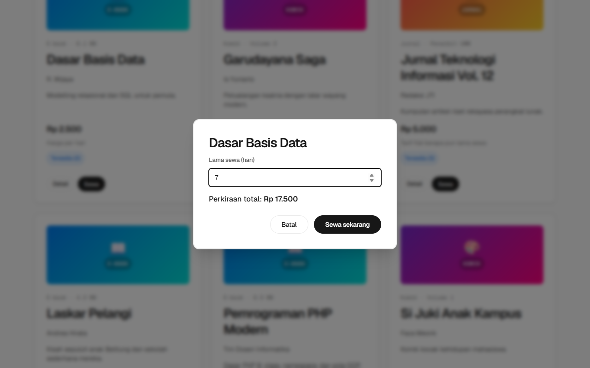 |

### Akun dan sewa

| Registrasi | Login |
|---|---|
| 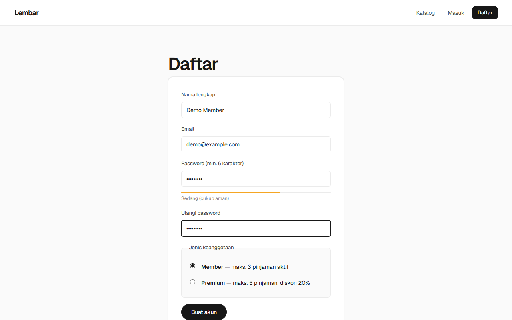 | 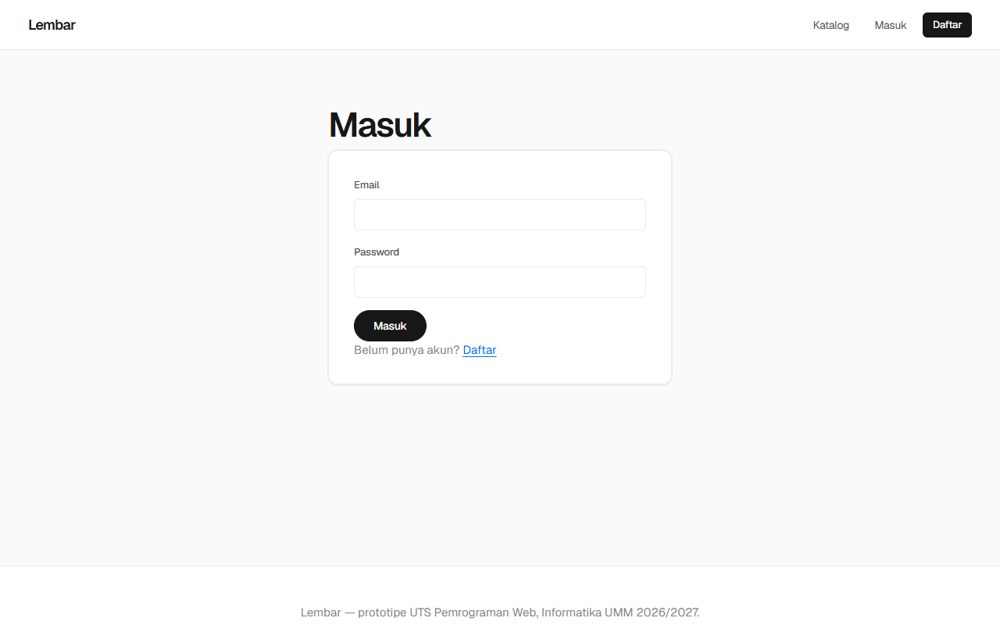 |

| Sewa Saya | Profil dan upgrade Premium |
|---|---|
| 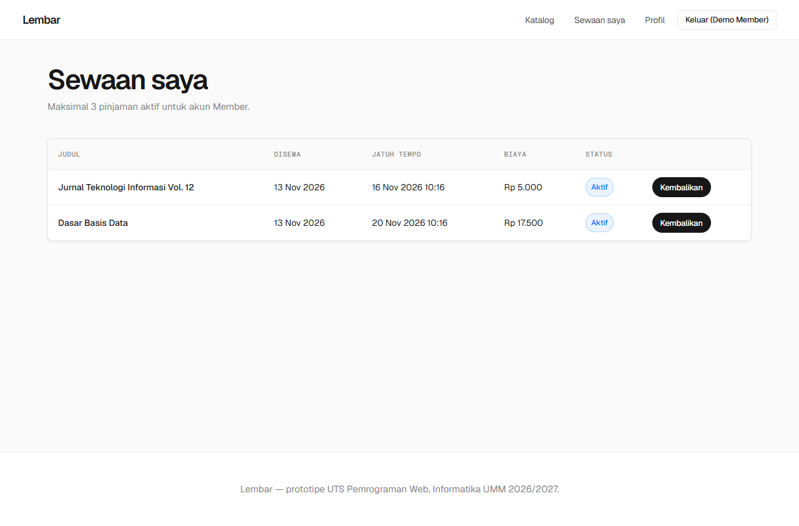 | 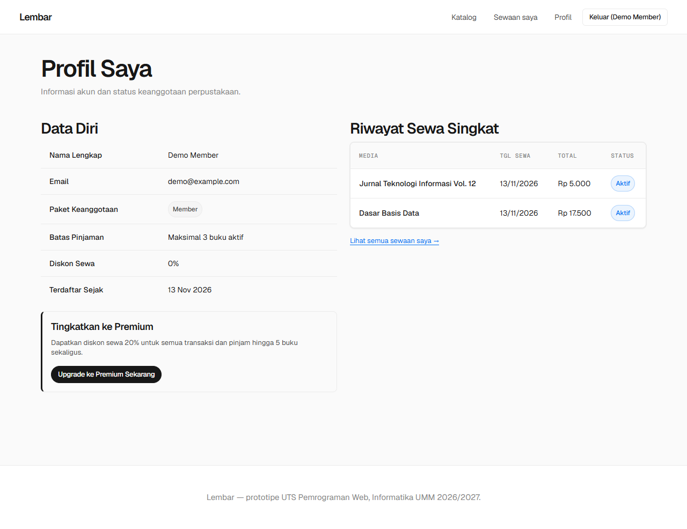 |

### Panel admin

| Dashboard | Edit media |
|---|---|
| 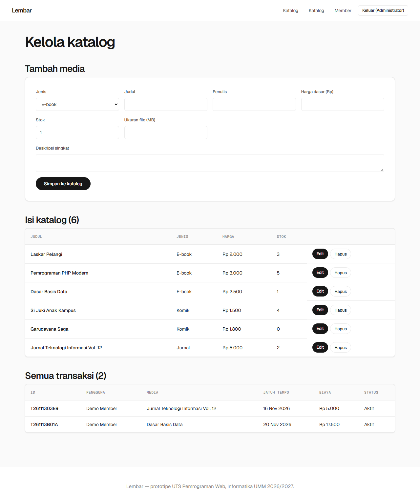 | 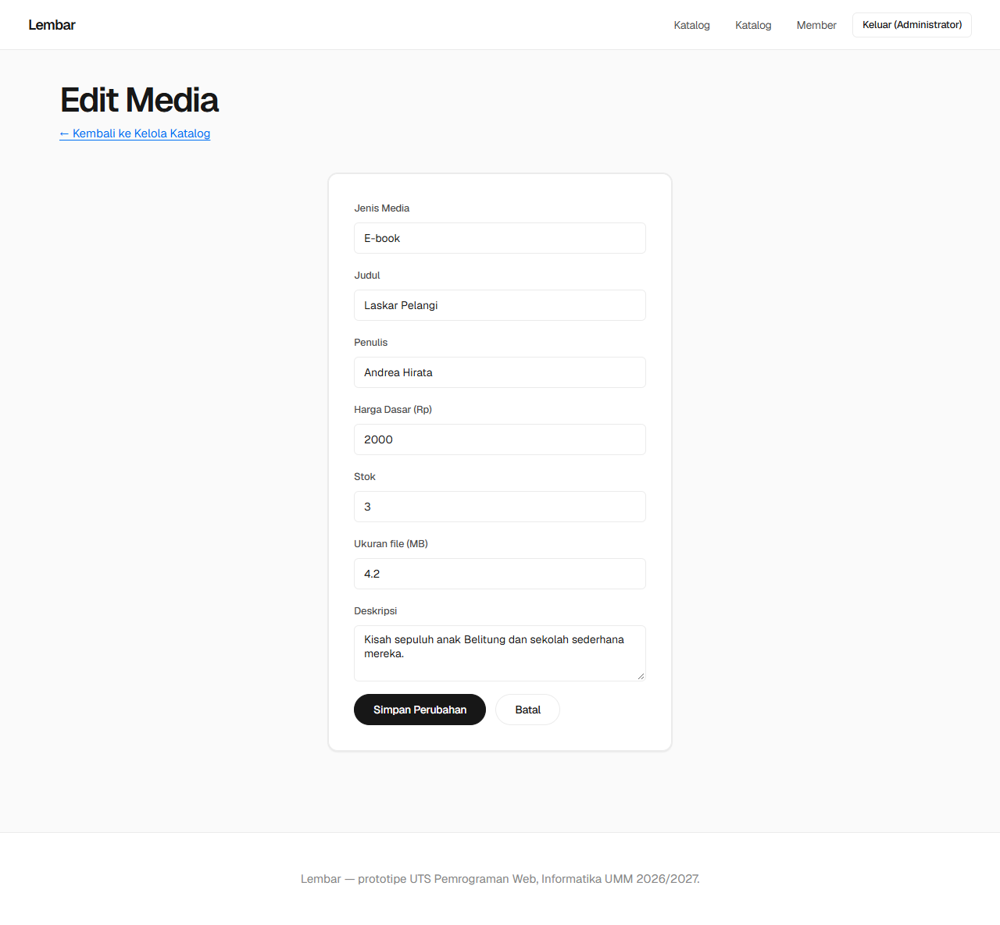 |

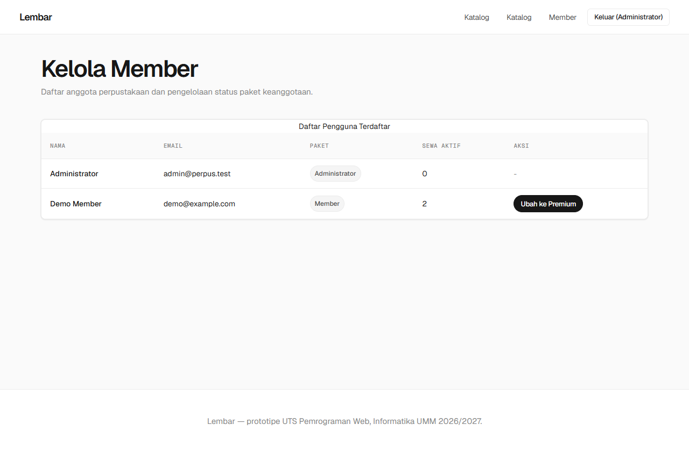

### Responsif

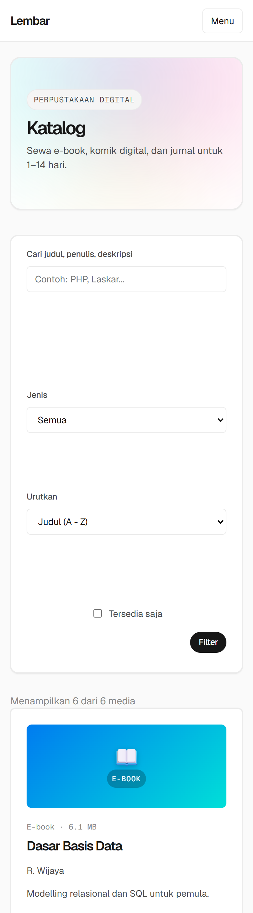

## Cara menjalankan

Syarat: PHP 8.1 atau lebih baru.

### Menggunakan Built-in PHP Server (CLI)
```bash
php -S localhost:8000 router.php
```

Buka http://localhost:8000

Akun admin otomatis dibuat saat pertama dijalankan:
- Email: `admin@perpus.test`
- Password: `admin123`

### Menjalankan di Laragon
1. Pastikan folder repo berada di root web Laragon (`C:\laragon\www\library-system`).
2. Aplikasi langsung muncul saat diakses via virtual host `http://library-system.test/` maupun subfolder `http://localhost/library-system/` tanpa konfigurasi document root tambahan (ditangani oleh `.htaccess` di root).

## Struktur folder

```
library-system/
├── index.php                # front controller (pintu masuk aplikasi)
├── router.php               # router untuk php -S bawaan CLI (blokir folder internal)
├── .htaccess                # konfigurasi Apache (Options -Indexes & proteksi folder internal)
├── assets/{css,js}/         # style.css, app.js
├── src/                     # semua kode PHP (namespace App\)
│   ├── autoload.php         # PSR-4 autoloader
│   ├── Contracts/           # interface (Rentable, StorageInterface)
│   ├── Enums/               # MediaType, Role (backed enum PHP 8.1)
│   ├── Traits/              # Timestampable (createdAt, updatedAt)
│   ├── Models/              # Media (abstract) -> Ebook, Comic, Journal
│   │                        # User (abstract) -> Member -> PremiumMember, Admin
│   │                        # Transaction (readonly id, userId, mediaId)
│   ├── Factories/           # MediaFactory, UserFactory
│   ├── Storage/             # JsonStorage (implements StorageInterface, atomik+flock)
│   ├── Repositories/        # BaseRepository -> Media/User/Transaction repository
│   ├── Services/            # AuthService, RentalService (aturan bisnis)
│   ├── Controllers/         # BaseController + Catalog/Auth/Rental/Admin
│   ├── Core/                # Application (router), View, Session
│   └── Exceptions/          # RentalException, ValidationException
├── views/                   # template HTML (layouts, catalog, auth, rental, admin)
├── data/                    # media.seed.json; media/users/transactions.json (.gitignored)
├── tests/                   # PriceTest.php (tes otomatis harga, enum, trait, denda)
└── docs/                    # [Dokumentasi lengkap](docs/README.md); screenshots/ berisi tangkapan layar untuk README
```

## Pemetaan ke rubrik

| Rubrik | Di mana |
|---|---|
| Class & Object | semua folder `src/` |
| Encapsulation | properti `protected/private/readonly` + getter (`Media`, `User`, `Transaction`) |
| Inheritance | `Media` → `Ebook/Comic/Journal`; `User` → `Member` → `PremiumMember`; `User` → `Admin`; `BaseRepository` → 3 repo |
| Polymorphism | `getRentalPrice()` (harga beda per tipe), `getMaxLoans()` & `getDiscount()` (beda per role) |
| Interface / abstract | `Rentable`, `StorageInterface`, `Media`, `User`, `BaseRepository` |
| Enum | `MediaType` (ebook/comic/journal), `Role` (admin/member/premium) — backed string enum PHP 8.1 |
| Trait | `Timestampable` (createdAt/updatedAt) di `Media`, `User`, `Transaction` |
| Namespace | `App\...` sesuai struktur folder (PSR-4) |
| Form validasi | `views/auth/*`, `views/admin/*` + `app.js` (klien) + `AuthService`/`AdminController` (server) |
| Semantik & responsif | `header/nav/main/footer`, `article`, `table` dengan `scope`, CSS grid + 3 breakpoint (mobile/tablet/desktop), dark mode |
| Interaktivitas JS | cari/filter/sort katalog, dialog sewa fetch+fallback, toast, password strength, konfirmasi aksi |

## Aturan bisnis

| Tipe | Harga |
|---|---|
| E-book | harga × hari |
| Komik | harga × hari, diskon 15% jika ≥ 7 hari |
| Jurnal | flat, berapa pun lama sewa |

| Role | Maks. pinjaman | Diskon |
|---|---|---|
| Member | 3 | 0% |
| Premium | 5 | 20% |
| Admin | tidak menyewa | - |

Lama sewa 1–14 hari. Denda keterlambatan Rp 1.000 per hari.

## Alur kerja Git yang disarankan

1. Satu orang membuat repo dan push struktur ini ke branch `main`.
2. Tiap anggota membuat branch `fitur/nama-fitur`, lalu pull request ke `main`.
3. Jangan edit file yang sama bersamaan; ikuti tabel pembagian tugas.
4. `data/*.json` jangan di-commit setelah dipakai uji coba (sudah ada di `.gitignore`).