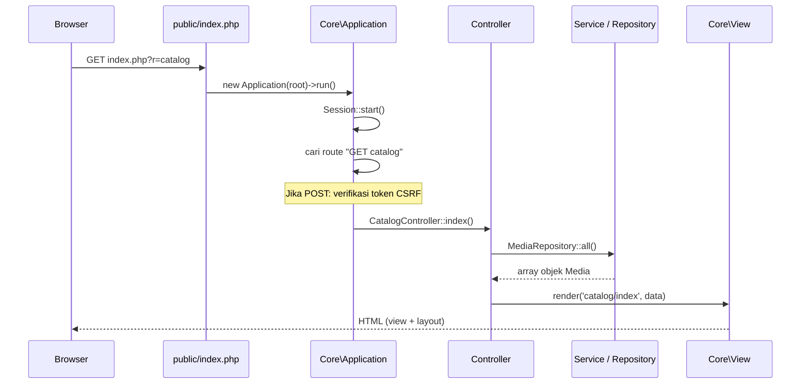
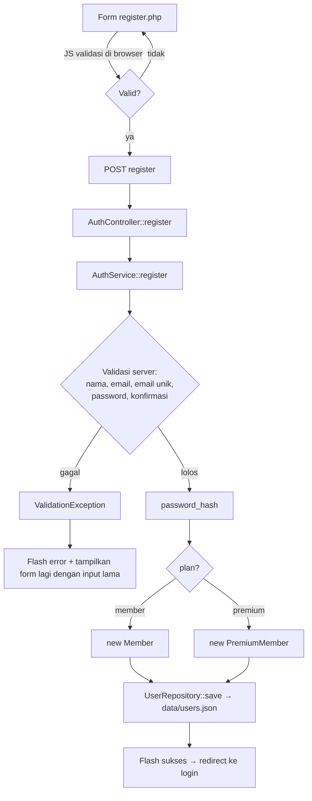
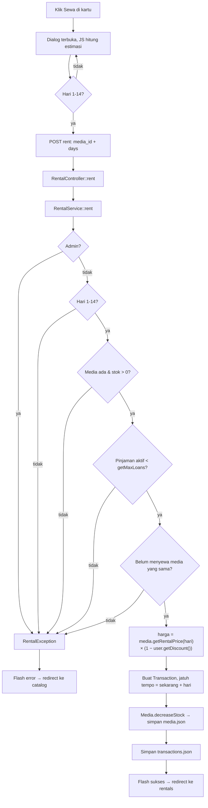

# Alur Aplikasi (Flow)

Dokumen ini menjelaskan bagaimana satu permintaan dari browser diproses sampai menjadi halaman, dan bagaimana tiap fitur mengalir antar kelas.

Dokumen terkait: [README](README.md) · [Pembagian tugas](PEMBAGIAN_TUGAS.md) · [Pemetaan rubrik](PEMETAAN_RUBRIK.md) · [Pengujian](PENGUJIAN.md)

## 1. Gambaran besar

```
Browser
   │  index.php?r=<route>
   ▼
public/index.php            ← pintu masuk (front controller)
   │
   ▼
Core\Application            ← cocokkan "METHOD route", cek CSRF, panggil controller
   │
   ▼
Controllers\*               ← terima input, panggil service/repository
   │
   ├──► Services\*          ← aturan bisnis (validasi, hitung harga, batas pinjam)
   │        │
   │        ▼
   │    Models\*            ← objek (Media, User, Transaction) + polimorfisme
   │        │
   │        ▼
   │    Repositories\*  ──► Storage\JsonStorage ──► data/*.json
   │
   ▼
Core\View                   ← gabungkan views/<halaman>.php + views/layouts/main.php
   │
   ▼
HTML dikirim ke browser  (+ assets/css/style.css, assets/js/app.js)
```

Prinsip pemisahan:

| Lapisan | Boleh tahu | Tidak boleh tahu |
|---|---|---|
| View (`views/`) | data yang dikirim controller | cara data disimpan |
| Controller | service, repository, view | detail format JSON |
| Service | model, repository | HTML, `$_POST` langsung |
| Repository | model, `JsonStorage` | aturan bisnis |
| Model | dirinya sendiri | penyimpanan, HTML |

## 2. Siklus satu permintaan



Langkah rinci:

1. Browser meminta `index.php?r=<nama-route>`. Tanpa `r`, default-nya `catalog`.
2. `public/index.php` memuat autoloader dan menjalankan `Application`.
3. `Application` (saat dibuat) merakit semua dependency: storage → repository → service → controller.
4. `run()` menyalakan session, membentuk kunci `"METHOD route"` (contoh `POST rent`), lalu mencarinya di tabel route.
5. Route tidak ada → halaman 404. Request POST tanpa token CSRF valid → ditolak (419).
6. Controller dipanggil, mengerjakan tugasnya, lalu **render** halaman atau **redirect**.

## 3. Tabel route

| Method | `?r=` | Controller::method | Akses |
|---|---|---|---|
| GET | `catalog` | `CatalogController::index` | publik |
| GET | `login` | `AuthController::showLogin` | publik |
| POST | `login` | `AuthController::login` | publik |
| GET | `register` | `AuthController::showRegister` | publik |
| POST | `register` | `AuthController::register` | publik |
| POST | `logout` | `AuthController::logout` | login |
| GET | `rentals` | `RentalController::myRentals` | login |
| POST | `rent` | `RentalController::rent` | login (bukan admin) |
| POST | `return` | `RentalController::giveBack` | login |
| GET | `admin` | `AdminController::dashboard` | admin |
| POST | `admin-add` | `AdminController::addMedia` | admin |
| POST | `admin-delete` | `AdminController::deleteMedia` | admin |

## 4. Alur per fitur

### 4.1 Daftar akun



### 4.2 Login dan logout

1. `POST login` → `AuthService::login()` mencari user lewat email, lalu `verifyPassword()`.
2. Salah → `ValidationException`, pesan error ditampilkan di form.
3. Benar → `user_id` disimpan di session, `session_regenerate_id()`, redirect:
   admin ke `admin`, lainnya ke `catalog`.
4. Setiap request berikutnya: `BaseController::user()` membaca `user_id` dari session dan memuat objek `User` dari repository. Objek ini bisa `Member`, `PremiumMember`, atau `Admin`.
5. Logout → session dihancurkan, redirect ke katalog.

`seedAdmin()` di `AuthService` membuat akun admin pertama jika `users.json` masih kosong.

### 4.3 Melihat katalog

1. `CatalogController::index` mengambil semua `Media` dari repository.
2. `MediaFactory` mengubah tiap baris JSON menjadi `Ebook`, `Comic`, atau `Journal` sesuai field `type`.
3. View membuat satu kartu per media. Atribut `data-*` pada kartu dipakai JS.
4. `app.js` menyaring kartu di browser (cari judul/penulis, jenis, hanya yang tersedia) tanpa reload.

### 4.4 Menyewa media



Titik polimorfisme di alur ini:

| Pemanggilan | Hasil tergantung pada |
|---|---|
| `$media->getRentalPrice($days)` | kelas asli: `Ebook`, `Comic`, atau `Journal` |
| `$user->getMaxLoans()` | `Member` (3), `PremiumMember` (5), `Admin` (0) |
| `$user->getDiscount()` | `Member` (0%), `PremiumMember` (20%) |

`RentalService` tidak perlu `if ($type == ...)`; cukup memanggil method yang sama pada objek yang berbeda.

### 4.5 Mengembalikan media

1. Di halaman `rentals`, tombol **Kembalikan** (ada konfirmasi dari JS) → `POST return` dengan `trx_id`.
2. `RentalService::returnMedia()` memeriksa: transaksi ada, milik user yang login, dan masih aktif.
3. `Transaction::markReturned()` mengisi waktu kembali. Jika lewat jatuh tempo, denda = jumlah hari terlambat (dibulatkan ke atas) × Rp 1.000.
4. Stok media ditambah lagi, lalu keduanya disimpan.
5. Flash sukses (plus info denda bila ada) → redirect ke `rentals`.

### 4.6 Admin mengelola katalog

- `GET admin` → `requireAdmin()` memastikan user adalah admin; menampilkan form tambah, daftar media, dan semua transaksi.
- `POST admin-add` → validasi dasar → `MediaFactory::fromArray()` membuat objek sesuai jenis → `MediaRepository::save()`.
  Kolom "extra" artinya berbeda per jenis: ukuran file (e-book), volume (komik), penerbit (jurnal).
- `POST admin-delete` → `MediaRepository::delete()`.

## 5. Alur data (penyimpanan)

```
Objek PHP  ──toArray()──►  array  ──json_encode──►  data/*.json
Objek PHP  ◄─Factory──────  array  ◄─json_decode──  data/*.json
```

| File | Isi | Dibuat oleh |
|---|---|---|
| `data/media.json` | katalog (data awal sudah disediakan) | `MediaRepository` |
| `data/users.json` | akun, password ter-hash | `UserRepository` |
| `data/transactions.json` | riwayat sewa | `TransactionRepository` |

`JsonStorage` memakai `LOCK_EX` saat menulis agar dua permintaan bersamaan tidak merusak file.

## 6. Alur di sisi browser (`app.js`)

| Fungsi | Dipicu oleh | Yang terjadi |
|---|---|---|
| `initNavToggle` | klik tombol Menu (layar kecil) | buka/tutup navigasi |
| `initCatalogFilter` | ketik/ubah filter | sembunyikan kartu yang tidak cocok, update jumlah hasil |
| `initRentDialog` | klik Sewa | buka `<dialog>`, hitung estimasi harga, cegah submit jika hari tidak valid |
| `initFormValidation` | form ber-atribut `data-validate` | cek wajib isi, email, panjang minimum, konfirmasi password |
| `initConfirmForms` | form ber-atribut `data-confirm` | tampilkan `confirm()` sebelum kirim |
| `initAdminExtraLabel` | ganti jenis media (admin) | ubah label kolom "extra" |

Validasi di browser hanya untuk kenyamanan. Pemeriksaan yang menentukan tetap di server (`AuthService`, `RentalService`, `AdminController`).

## 7. Keamanan dasar yang sudah ada

| Risiko | Penanganan |
|---|---|
| XSS | semua output lewat `View::e()` (`htmlspecialchars`) |
| CSRF | token di setiap form POST, diverifikasi di `Application::run()` |
| Password bocor | `password_hash` / `password_verify` |
| Session fixation | `session_regenerate_id(true)` setelah login |
| Akses tanpa izin | `requireLogin()` dan `requireAdmin()` di controller |
| Data dibaca langsung | hanya `public/` yang diakses web; `data/` dilindungi `.htaccess` |
